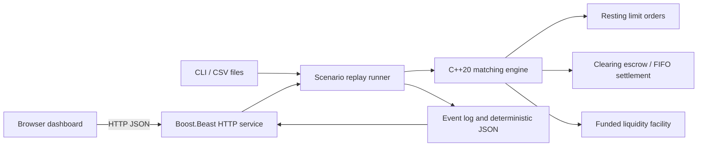

# Architecture and financial model

## System boundaries

The HTTP server is intentionally **stateless**. Each request creates a fresh `Exchange` and executes one bounded script, so two independent requests cannot race on the same account. Four workers and a capacity-64 work queue allow concurrent requests; there is no order-book state shared across workers. All mutable state is owned by the corresponding `Simulation` object.

## Trade lifecycle and conservation

An account has `(cash_cents, reserved_cash_cents, shares, reserved_shares)`. Buyers reserve `limit_price × remaining_quantity`. Sellers reserve unfilled shares. Reservations prevent two simultaneous (within replay order) attempts from spending the same funds.

When an incoming limit order crosses the best opposite-side resting order, execution occurs at the **resting price**. The buyer's account cash falls by `execution_price × filled_quantity`, the seller's shares fall by the quantity, and both amounts enter clearing escrow. The buyer's shares and seller's proceeds **are not yet credited**. The resting order is selected by best price, then earliest sequence. Partial orders keep their remaining reservations. Price improvement releases the gap between the limit reservation and executed cash.

`SETTLE` processes pending fills FIFO; `SETTLE,n` processes at most `n`. Each settlement atomically delivers escrow cash to the seller and escrow shares to the buyer in one synchronous operation. If payments are offline, settlement does nothing; the pending trade remains intact. Cancelling an order frees only the unfilled remainder, not already executed amounts.

After **every** replay command, `verify_invariants()` checks:

1. `sum(account.cash) + escrow.cash == initial.cash`.
2. `sum(account.shares) + escrow.shares == initial.shares`.
3. Available assets are never negative, and reservations equal all open order remainders.
4. Clearing balances equal the exact values of pending trade records.
5. Every trade has internally consistent price, quantity, notional, and settlement state; totals match counters.
6. Loans are non-negative, belong to known accounts, and never increase system cash.

The amounts are signed 64-bit integer cents, not floating point. Limits bound multiplication and cumulative notional. There is **one synthetic share type** and one currency, USD cents, with no FX conversion.

## Propagation mechanism

In the main four-party chain, NOVA buys from BEACON; BEACON intends to use that cash to buy from CIRRUS; CIRRUS intends to buy from DELTA. During a payments outage, the first trade's $400 cannot leave clearing escrow. BEACON and CIRRUS cannot fund their planned buys and those orders are rejected. The model includes no margin or instant credit. Explicit cancellations in failure scripts remove stale asks, so self-trade prevention does not obscure funding-related rejections.

There are two distinct mitigations:

- **Early infrastructure recovery**: payments are restored and the $400 is delivered before BEACON places its next order. All three trades execute and settle.
- **Liquidity backstop**: the pre-funded `FACILITY` loans $360 and $300 from its existing cash to BEACON and CIRRUS, respectively. Both can place the trades while payments remain offline; after the payment system recovers, settlements deliver proceeds and borrowers repay $660. No money is created, no fee is charged, and no additional debt remains.

The facility is not a real-world central bank implementation. The loan model intentionally excludes collateral haircuts, credit loss, interest, limits by borrower, and insolvency. A persistent outage still prevents final delivery even if funding permits more execution.

## Risk controls

- `MAX_NOTIONAL`: incoming order limit notional cannot exceed the configured limit.
- `PRICE_BAND`: incoming orders cannot execute against any crossing resting order outside a configured fixed reference-price ± band in **basis points**. In this simplified engine, such an entire incoming order is rejected before reservation; it is *not* a market-wide trading halt.
- Self-trades are prevented before any fill for the incoming order; order IDs cannot be reused during the same run.
- Input validation rejects oversized quantities, negative cash, unsupported sides, duplicate IDs, malformed commands and late account declarations.

Risk and input errors are reported separately: malformed syntax aborts the request, while business rejections (insufficient available cash, self-trade, etc.) appear in the event trace and the script continues. There is no partial mutation of a **server-side persisted account** because each request has no externally persisted state.

## Complexity and scalability

The matching engine uses a `std::vector` and scans resting orders for the best price/time candidate: **O(N)** per selected match, with vector erasure O(N), appropriate for bounded educational scenarios and easy to debug. In a production exchange, sorted price levels / FIFO queues and ID indexes would reduce lookup costs. That is a sensible follow-on optimization *after* collecting relevant benchmark profiles.

JSON is generated with a small, controlled serializer that escapes strings and serializes numeric cents without loss of precision. The UI receives it via same-origin requests and adds user-generated text with DOM `textContent`, never HTML injection. A richer JSON library would be preferable if request schemas grow beyond raw CSV.

Potential extensions with real payoff: market-depth indexes, property-based and fuzz testing, checkpointed event logs, reproducible randomized workloads, latency histograms, persistent event storage when a genuine multi-user requirement emerges, and an explicit CCP counterparty network with margin / netting / waterfalls. Do not add these as decorations; each needs a requirement and an invariant.

## Failure / security boundaries

This service is a local demo, not a public distributed system. It has an exact route allowlist, per-request parser limits, bounded workers, 5-second request read timeout, and restrictive browser headers. It is intentionally missing public internet authentication, TLS termination, quotas per identity, and operation-level authorization. Docker Compose publishes only to loopback and runs without root. See [SECURITY.md](SECURITY.md).
